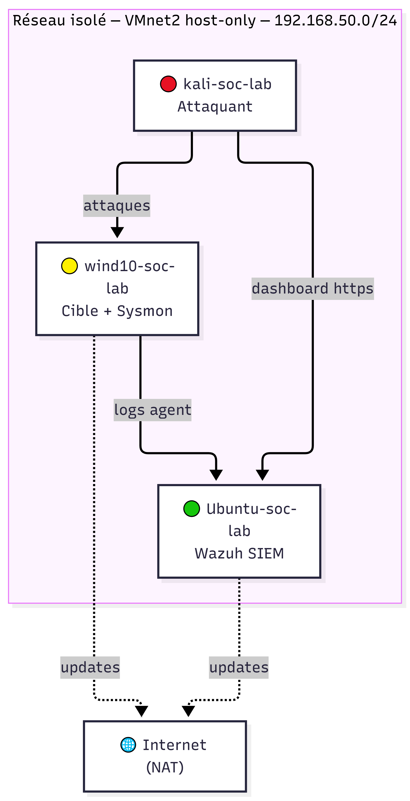

# Architecture du lab

## Réseau :
- **VMnet2** : réseau Host-only isolé, dédié au lab
- Plage d'adresses : 192.168.50.0/24
- Aucun accès Internet direct sur ce réseau (isolation volontaire)

## Machines virtuelles :

### kali-soc-lab — Attaquant
- RAM : 1,5-2 Go
- Réseau : VMnet2 uniquement
- Rôle : lance les attaques (scan, brute force, exploitation)
### wind10-soc-lab — Cible
- RAM : 2 Go
- Réseau : VMnet2 + NAT
- Rôle : machine surveillée (agent Wazuh + Sysmon installés)

### Ubuntu-soc-lab (Wazuh) — SIEM
- RAM : 2-2,5 Go
- Réseau : VMnet2 + NAT
- Rôle : collecte les logs, génère les alertes, dashboard de supervision

## Pourquoi un réseau isolé (VMnet2) ?
Le lab tourne sur un réseau Host-only séparé du réseau NAT par défaut de VMware,
pour éviter que les attaques lancées depuis Kali touchent accidentellement
d'autres VM ou sortent vers Internet. Une 2ᵉ carte réseau NAT est ajoutée
uniquement sur Windows et Wazuh pour leur permettre de télécharger des outils
et mises à jour.

## Schéma
S
